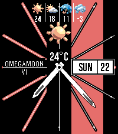

<!-- Generated by scripts/update_app_directory.py: do not edit by hand -->
[← All Pebble Developers](../developers.md)

# Omegamoon

*1 watchface · Last updated 2026-11-23 · [About these lists](../about-app-lists.md)*

Links: [Pebble App Store](https://apps.repebble.com/apps/dev/omegamoon_76461a8c9f6f04c090635dc7) · [GitHub (omegamoon)](https://github.com/omegamoon)

<h2 class="app-name" id="app-641f6164a82e4f4d8ec3b1fa"><a href="https://apps.repebble.com/641f6164a82e4f4d8ec3b1fa">Omegamoon-VI</a> v1.1.0</h2>
<a class="app-source" href="https://github.com/omegamoon/pebble-watchfaces/wiki/Omegamoon-VI-Watchface" title="Source code" data-search-exclude>View source</a>

Watchface

No licence Released 2026-11-21 Updated 2026-11-22

Runs on: Round 2, Time 2

Omegamoon-VI is a configurable analog watchface inspired by retro instrument watches, with a dark dial, contrasting color field, applied indices, sculpted hands, and day/date display. Show live…

