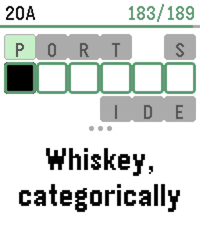

<!-- Generated by scripts/update_app_directory.py: do not edit by hand -->
[← All Pebble Developers](../developers.md)

# OmgSlayKween

*1 watchface and 2 apps · Last updated 2026-10-11 · [About these lists](../about-app-lists.md)*

Links: [Pebble App Store](https://apps.repebble.com/apps/dev/omgslaykween_6a8876179a73d00009ee3f1a) · [GitHub (hornofabraxas)](https://github.com/hornofabraxas) · [Website (reddit.com)](https://www.reddit.com/user/OmgSlayKween/)

<button type="button" data-filter="all" aria-pressed="true">All 3</button><button type="button" data-filter="watchface" aria-pressed="false">Watchfaces 1</button><button type="button" data-filter="watchapp" aria-pressed="false">Apps 2</button>

<label class="dev-sort">Sort by <select><option value="updated">Recently updated</option><option value="released">Newest release</option><option value="title">A–Z</option></select></label>

<h2 class="app-name" id="app-6abc2c15139b70000a509eb9"><a href="https://apps.repebble.com/6abc2c15139b70000a509eb9">Parallax Weather</a> v1.1</h2>
<a class="app-source" href="https://github.com/hornofabraxas/parallax-weather" title="Source code" data-search-exclude>View source</a>

Watchface · <a href="https://forum.rebble.io/t/1391" title="Discuss this app on the Rebble forum" data-search-exclude>Forum thread</a>

Released 2026-09-29 Updated 2026-10-02

Runs on: Round 2, Time 2

Big, visible numbers - and configurable live weather backgrounds that move as you tilt your wrist (during backlight only, to save battery). Also includes a live moonphase background and several…

<h2 class="app-name" id="app-6aab02d087b66c0009820cc3"><a href="https://apps.repebble.com/6aab02d087b66c0009820cc3">Clock Dude</a> v1.0</h2>
<a class="app-source" href="https://github.com/hornofabraxas/clock-dude" title="Source code" data-search-exclude>View source</a>

App · <a href="https://forum.rebble.io/t/1365" title="Discuss this app on the Rebble forum" data-search-exclude>Forum thread</a>

Released 2026-09-16 Updated 2026-09-16

Runs on: Round 2, Time 2

This is a Time 2 / Round 2 touch-input port of Block Dude, a block-pushing puzzle game written by Brandon Sterner for the TI-83 in 1999, and the reason many of us failed Calculus. The eleven…

<h2 class="app-name" id="app-6aa22e17c73fab0009866dfc"><a href="https://apps.repebble.com/6aa22e17c73fab0009866dfc">DownTime: Voice Crosswords</a> v1.1</h2>
<a class="app-source" href="https://github.com/hornofabraxas/pebble-crossword" title="Source code" data-search-exclude>View source</a>

App · <a href="https://forum.rebble.io/t/1346" title="Discuss this app on the Rebble forum" data-search-exclude>Forum thread</a>

Released 2026-09-10 Updated 2026-09-10

Runs on: Time 2

DownTime is an offline collection of 200 new crossword puzzles (9,000+ clues), supporting dictation for speech-to-text, or bespoke on-watch typing. It uses a custom crossword engine which displays…

