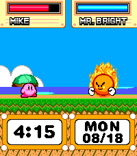

<!-- Generated by scripts/update_app_directory.py: do not edit by hand -->
[← All Pebble Developers](../developers.md)

# Ongion

*1 watchface · Last updated 2026-10-11 · [About these lists](../about-app-lists.md)*

Links: [Pebble App Store](https://apps.repebble.com/apps/dev/ongion_68812a0735f0cc0009d17723) · [GitHub (Ongion)](https://github.com/Ongion)

<h2 class="app-name" id="app-68a395ae8722670009a23809"><a href="https://apps.repebble.com/68a395ae8722670009a23809">Kirby</a> v2.11.0</h2>
<a class="app-source" href="https://github.com/Ongion/KirbyWatchface/" title="Source code" data-search-exclude>View source</a>

Watchface · <a href="https://forum.rebble.io/t/365" title="Discuss this app on the Rebble forum" data-search-exclude>Forum thread</a>

No licence Released 2025-08-18 Updated 2026-05-19

Runs on: Round 2, Time 2, Time Round, Time

He&#x27;s small, he&#x27;s pink, he&#x27;s shaped like a friend, and now he&#x27;s on your Pebble! It&#x27;s Kirby! Features - Animations - Kirby has 9+ animations! He changes abilities each hour, and animates when you…

