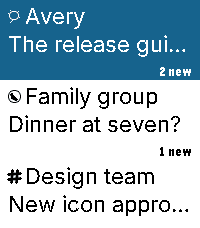
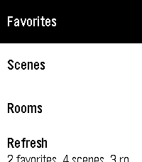
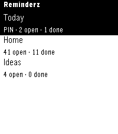

<!-- Generated by scripts/update_app_directory.py: do not edit by hand -->
[← All Pebble Developers](../developers.md)

# Organik Apps

*4 apps · Last updated 2026-10-12 · [About these lists](../about-app-lists.md)*

Links: [Pebble App Store](https://apps.repebble.com/apps/dev/organik-apps_7d03e7e4a48fa1d6c0de8596) · [GitHub (GeezusChrotch)](https://github.com/GeezusChrotch) · [Website (geezuschrotch.github.io)](https://geezuschrotch.github.io/beepster/INSTALL)

<button type="button" data-filter="all" aria-pressed="true">All 4</button><button type="button" data-filter="watchface" aria-pressed="false" disabled>Watchfaces 0</button><button type="button" data-filter="watchapp" aria-pressed="false">Apps 4</button>

<label class="dev-sort">Sort by <select><option value="updated">Recently updated</option><option value="released">Newest release</option><option value="title">A–Z</option></select></label>

<h2 class="app-name" id="app-d2ee8ca7db384c6ca9eefa57"><a href="https://apps.repebble.com/d2ee8ca7db384c6ca9eefa57">Beepster</a> v0.21.0</h2>
<a class="app-source" href="https://github.com/GeezusChrotch/beepster" title="Source code" data-search-exclude>View source</a>

App

MIT Released 2026-09-04 Updated 2026-09-09

Runs on: Time 2

An independent, free, open-source Beeper client for Pebble Time 2. Read chats, dictate replies, use saved replies and bitmap emoji, and view full-width photos. Reactions appear beneath messages…

<h2 class="app-name" id="app-f8d530f36d5a44aa85d1c137"><a href="https://apps.repebble.com/f8d530f36d5a44aa85d1c137">Pome</a> v3.0.0</h2>
<a class="app-source" href="https://github.com/GeezusChrotch/pome" title="Source code" data-search-exclude>View source</a>

App

MIT Released 2026-08-31 Updated 2026-09-08

Runs on: Time 2, Time

Pome puts Apple Home controls on Pebble Time and Time 2 through Itsyhome on your Mac. Make your Home Screen yours: pin scenes, rooms, devices and sensors, then drag to reorder pins and sections in…

<h2 class="app-name" id="app-a9d4515681c34b5088993dc6"><a href="https://apps.repebble.com/a9d4515681c34b5088993dc6">Notesy</a> v1.4.8</h2>
<a class="app-source" href="https://github.com/GeezusChrotch/notesy" title="Source code" data-search-exclude>View source</a>

App

MIT Released 2026-09-05 Updated 2026-09-08

Runs on: Time 2, Time

Your Obsidian vault, on your wrist. Free, MIT open source, public beta. Dictate new notes or append to existing ones. Quick Dictate captures a 15-second recording; Stitch joins sections into…

<h2 class="app-name" id="app-d7f2ccd94a0746d1a059433a"><a href="https://apps.repebble.com/d7f2ccd94a0746d1a059433a">Remindery</a> v1.4.2</h2>
<a class="app-source" href="https://github.com/GeezusChrotch/reminderz" title="Source code" data-search-exclude>View source</a>

App

MIT Released 2026-09-04 Updated 2026-09-07

Runs on: Time 2, Time

Remindery brings Apple Reminders to Pebble Time and Pebble Time 2. Browse lists, check or reopen reminders, dictate new items, and delete with confirmation. Pin favorite lists and browse every…

