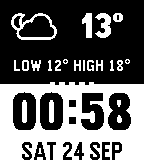
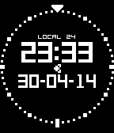
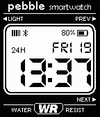

<!-- Generated by scripts/update_app_directory.py: do not edit by hand -->
[← All Pebble Developers](../developers.md)

# orviwan

*6 watchfaces and 1 app · Last updated 2026-10-11 · [About these lists](../about-app-lists.md)*

Links: [Pebble App Store](https://apps.repebble.com/apps/dev/orviwan_5299c96ae627ce3692000095) · [GitHub (orviwan)](https://github.com/orviwan) · [GitHub (pebble-hacks)](https://github.com/pebble-hacks)

<button type="button" data-filter="all" aria-pressed="true">All 7</button><button type="button" data-filter="watchface" aria-pressed="false">Watchfaces 6</button><button type="button" data-filter="watchapp" aria-pressed="false">Apps 1</button>

<label class="dev-sort">Sort by <select><option value="updated">Recently updated</option><option value="released">Newest release</option><option value="title">A–Z</option></select></label>

<h2 class="app-name" id="app-52d7e8d71acbf3ff09000008"><a href="https://apps.repebble.com/52d7e8d71acbf3ff09000008">Chunk Weather</a> v4.0</h2>
<a class="app-source" href="https://github.com/orviwan/Chunk-Weather-v2.0" title="Source code" data-search-exclude>View source</a>

Watchface

Released 2014-01-16 Updated 2025-07-26

Runs on: Round 2, Time 2, Pebble 2 Duo, Pebble 2, Time Round, Time, Classic

YAWWF (Yet Another Weather Watch Face) It uses Yahoo! Weather, has 48 weather conditions and updates every 30 minutes. Configuration options: - Choose a colours for top/bottom halves - Weather…

<h2 class="app-name" id="app-543f02a145b1f75605000010"><a href="https://apps.repebble.com/543f02a145b1f75605000010">Button Lock for Pebble</a> v1.2</h2>
<a class="app-source" href="https://github.com/orviwan/ButtonLockForPebble" title="Source code" data-search-exclude>View source</a>

App

Released 2014-10-15 Updated 2016-01-30

Runs on: Round 2, Time 2, Pebble 2 Duo, Pebble 2, Time Round, Time, Classic

Prevents accidental button presses, this actually does nothing when you press a button. Assign the app as one of your quick launch apps, then lock your Pebble with a single long press of a button…

<h2 class="app-name" id="app-52dd9c3df9d8ec91e8000026"><a href="https://apps.repebble.com/52dd9c3df9d8ec91e8000026">Aviator</a> v2.3</h2>
<a class="app-source" href="https://github.com/pebble-hacks/aviator" title="Source code" data-search-exclude>View source</a>

Watchface

Released 2014-01-20 Updated 2015-10-09

Runs on: Round 2, Time 2, Pebble 2 Duo, Pebble 2, Time Round, Time, Classic

An aviation-inspired watch face with configurable styles. 12h/24h Toggle &quot;Seconds&quot; Invert Bluetooth vibration Vibration timer (Minutes) Toggle &quot;Hands&quot; International/US date or Local/Timezone…

<h2 class="app-name" id="app-554e08d40136b0e6e200001b"><a href="https://apps.repebble.com/554e08d40136b0e6e200001b">91 Dub v2.0</a> v2.9</h2>
<a class="app-source" href="https://github.com/orviwan/91-Dub-v2.0" title="Source code" data-search-exclude>View source</a>

Watchface

Released 2015-05-09 Updated 2015-05-09

Runs on: Time 2, Pebble 2 Duo, Pebble 2, Time, Classic

The original and best fairly classic watch face, optimised and updated for Pebble 2.0. If you love it as much as I do, give it a LIKE. This watch face has been superseded by v3.0, this version has…

<h2 class="app-name" id="app-54dd307eadaf1d9f0c000029"><a href="https://apps.repebble.com/54dd307eadaf1d9f0c000029">Rorschach by IGotAKnife</a> v1.0</h2>
<a class="app-source" href="https://github.com/orviwan/Rorschach_for_Pebble" title="Source code" data-search-exclude>View source</a>

Watchface

Released 2015-02-12 Updated 2015-02-12

Runs on: Time 2, Pebble 2 Duo, Pebble 2, Time, Classic

Initial release, animated on the second. Plenty of improvements could be made. Let me know!

<h2 class="app-name" id="app-54b9a46242ea1d044d0000b4"><a href="https://apps.repebble.com/54b9a46242ea1d044d0000b4">Hypno</a> v1.0</h2>
<a class="app-source" href="https://github.com/orviwan/HypnoAnim" title="Source code" data-search-exclude>View source</a>

Watchface

Released 2015-01-16 Updated 2015-01-16

Runs on: Time 2, Pebble 2 Duo, Pebble 2, Time, Classic

Animated hypnotic digits. Thanks to Edwin Finch [http://edwinfinch.com]

<h2 class="app-name" id="app-5357af24a54fda8a73000036"><a href="https://apps.repebble.com/5357af24a54fda8a73000036">Transfont 2.0</a> v1.3</h2>
<a class="app-source" href="https://github.com/orviwan/Transfont-2.0" title="Source code" data-search-exclude>View source</a>

Watchface

Released 2014-04-23 Updated 2014-04-30

Runs on: Time 2, Pebble 2 Duo, Pebble 2, Time, Classic

Simple watch face using the Transformers font. Needs a bit more work TBH, but someone requested it.

