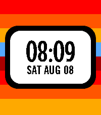
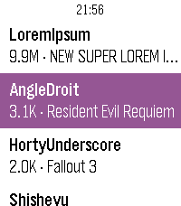

<!-- Generated by scripts/update_app_directory.py: do not edit by hand -->
[← All Pebble Developers](../developers.md)

# outadoc

*1 watchface and 1 app · Last updated 2026-10-12 · [About these lists](../about-app-lists.md)*

Links: [Pebble App Store](https://apps.repebble.com/apps/dev/outadoc_52ff411d6061bd63ba000032) · [GitHub (outadoc)](https://github.com/outadoc)

<button type="button" data-filter="all" aria-pressed="true">All 2</button><button type="button" data-filter="watchface" aria-pressed="false">Watchfaces 1</button><button type="button" data-filter="watchapp" aria-pressed="false">Apps 1</button>

<label class="dev-sort">Sort by <select><option value="updated">Recently updated</option><option value="released">Newest release</option><option value="title">A–Z</option></select></label>

<h2 class="app-name" id="app-89f998c3a4024920944ffd53"><a href="https://apps.repebble.com/89f998c3a4024920944ffd53">Game Changer</a> v1.0.1</h2>
<a class="app-source" href="https://github.com/outadoc/pebble-gamechanger" title="Source code" data-search-exclude>View source</a>

Watchface

Released 2026-08-08 Updated 2026-08-08

Runs on: Round 2, Time 2, Time Round, Time

Get ready for a Game Changer! This watchface is inspired by the title card of the popular Dropout show.

<h2 class="app-name" id="app-3c13fa7a4d7144ae98bba3c6"><a href="https://apps.repebble.com/3c13fa7a4d7144ae98bba3c6">Twebble for Twitch</a> v1.5.0</h2>
<a class="app-source" href="https://github.com/outadoc/pebble-twitch" title="Source code" data-search-exclude>View source</a>

App

Released 2026-04-05 Updated 2026-04-09

Runs on: Round 2, Time 2, Pebble 2 Duo, Pebble 2, Time Round, Time, Classic

Twebble is a Pebble app to see what the streamers you follow are currently playing on Twitch!

