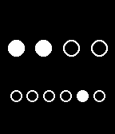

<!-- Generated by scripts/update_app_directory.py: do not edit by hand -->
[← All Pebble Developers](../developers.md)

# Ovidiu A.

*2 watchfaces · Last updated 2026-10-12 · [About these lists](../about-app-lists.md)*

Links: [Pebble App Store](https://apps.repebble.com/apps/dev/ovidiu-a_545df03eb8caab2ea700003b)

<button type="button" data-filter="all" aria-pressed="true">All 2</button><button type="button" data-filter="watchface" aria-pressed="false">Watchfaces 2</button><button type="button" data-filter="watchapp" aria-pressed="false" disabled>Apps 0</button>

<label class="dev-sort">Sort by <select><option value="updated">Recently updated</option><option value="released">Newest release</option><option value="title">A–Z</option></select></label>

<h2 class="app-name" id="app-5474fd8914b37fd5a50000d2"><a href="https://apps.repebble.com/5474fd8914b37fd5a50000d2">Binary Dots</a> v1.2</h2>
<a class="app-source" href="http://corero.byethost7.com/sources/binarydots_4.zip" title="Source code" data-search-exclude>View source</a>

Watchface

Released 2014-11-25 Updated 2015-04-26

Runs on: Time 2, Pebble 2 Duo, Pebble 2, Time, Classic

Simple binary watch... animated!

<h2 class="app-name" id="app-5470f9ed54f824d3530000ef"><a href="https://apps.repebble.com/5470f9ed54f824d3530000ef">TextWatch RO2</a> v1.2</h2>
<a class="app-source" href="http://corero.byethost7.com/sources/textwatch_ro2_3.zip" title="Source code" data-search-exclude>View source</a>

Watchface

Released 2014-11-22 Updated 2014-12-01

Runs on: Time 2, Pebble 2 Duo, Pebble 2, Time, Classic

This watchface is based on TextWatch RO, but with some fixes.

