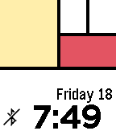

<!-- Generated by scripts/update_app_directory.py: do not edit by hand -->
[← All Pebble Developers](../developers.md)

# Owen B

*2 watchfaces · Last updated 2026-10-12 · [About these lists](../about-app-lists.md)*

Links: [Pebble App Store](https://apps.repebble.com/apps/dev/owen-b_535fc8b0cabddcdb760000c1) · [GitHub (obitoo)](https://github.com/obitoo) · [Website (forums.getpebble.com)](https://forums.getpebble.com/discussion/19595/watchface-tide-forecasts-now-worldwide?new=1)

<button type="button" data-filter="all" aria-pressed="true">All 2</button><button type="button" data-filter="watchface" aria-pressed="false">Watchfaces 2</button><button type="button" data-filter="watchapp" aria-pressed="false" disabled>Apps 0</button>

<label class="dev-sort">Sort by <select><option value="updated">Recently updated</option><option value="released">Newest release</option><option value="title">A–Z</option></select></label>

<h2 class="app-name" id="app-54980fdd9fa273b3860000a3"><a href="https://apps.repebble.com/54980fdd9fa273b3860000a3">Tides</a> v4.2</h2>
<a class="app-source" href="https://github.com/obitoo/PebbleTidesUK" title="Source code" data-search-exclude>View source</a>

Watchface

Released 2014-12-22 Updated 2017-01-27

Runs on: Time 2, Pebble 2 Duo, Pebble 2, Time, Classic

Latest tidal graphs on your wrist! Choose from over 4000 ports in 129 countries worldwide. UPDATE Jan 2016: Double tides: Easytide have changed the way they handle double high tides. As a…

<h2 class="app-name" id="app-554f9bc04e604b446200006d"><a href="https://apps.repebble.com/554f9bc04e604b446200006d">Mondrian</a> v1.21</h2>
<a class="app-source" href="https://github.com/obitoo/PebbleMondrian" title="Source code" data-search-exclude>View source</a>

Watchface

Released 2015-05-10 Updated 2015-09-18

Runs on: Time 2, Time

Release 1.2: Added Bluetooth disconnect icon A nerdy little colour watchface. Hours are Blue, Minutes are Yellow, and Red for Both. Can you figure out how it works? (Hint : 5, 3, 2, 1 ,1)

