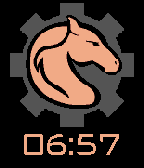

<!-- Generated by scripts/update_app_directory.py: do not edit by hand -->
[← All Pebble Developers](../developers.md)

# Owen D&\#x27;Aprile

*1 watchface · Last updated 2026-10-11 · [About these lists](../about-app-lists.md)*

Links: [Pebble App Store](https://apps.repebble.com/apps/dev/owen-d-aprile_56b7b8c0ff77465cf7000035) · [GitHub (teddyfrozevelt)](https://github.com/teddyfrozevelt)

<h2 class="app-name" id="app-56f7132991445bb86d000018"><a href="https://apps.repebble.com/56f7132991445bb86d000018">Robostangs Team 548</a> v1.3</h2>
<a class="app-source" href="https://github.com/teddyfrozevelt/robostangs-team-548" title="Source code" data-search-exclude>View source</a>

Watchface

Released 2016-03-26 Updated 2016-04-29

Runs on: Round 2, Time 2, Pebble 2 Duo, Pebble 2, Time Round, Time, Classic

A watchface dedicated to the FRC Team, the Robostangs, Team 548. It is my first watchface.

