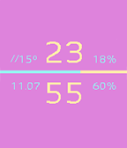

<!-- Generated by scripts/update_app_directory.py: do not edit by hand -->
[← All Pebble Developers](../developers.md)

# P-ta

*1 watchface · Last updated 2026-10-12 · [About these lists](../about-app-lists.md)*

Links: [Rebble App Store](https://apps.rebble.io/en_US/developer/5c73e4c559a745000118875f/1) · [GitHub (p-ta)](https://github.com/p-ta)

<h2 class="app-name" id="app-68740a7365207500093d5a9f"><a href="https://apps.rebble.io/en_US/application/68740a7365207500093d5a9f">Skagen</a> v1.2</h2>
<a class="app-source" href="https://github.com/p-ta/Skagen_Pebble_Watchface.git" title="Source code" data-search-exclude>View source</a>

Watchface

Released 2025-07-13 Updated 2025-07-20 Rebble App Store

Runs on: Round 2, Time 2, Time Round, Time

A simple watch face like the one from the Skagen Falster series. With time, date, weather, battery, and phone battery. And Stepmeter to 10000.

