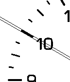

<!-- Generated by scripts/update_app_directory.py: do not edit by hand -->
[← All Pebble Developers](../developers.md)

# p10n.net

*1 watchface · Last updated 2026-10-11 · [About these lists](../about-app-lists.md)*

Links: [Pebble App Store](https://apps.repebble.com/apps/dev/p10n-net_529a2241e627ce90540000d8) · [Website (p10n.net)](http://p10n.net/zoooom)

<h2 class="app-name" id="app-52fd607249e544cf9a000477"><a href="https://apps.repebble.com/52fd607249e544cf9a000477">Zoooom (hop-picker)</a> v1.0.2</h2>
<a class="app-source" href="http://hop-picker.tumblr.com/" title="Source code" data-search-exclude>View source</a>

Watchface

Released 2014-02-14 Updated 2014-02-19

Runs on: Time 2, Pebble 2 Duo, Pebble 2, Time, Classic

In cooperation with the original creator Konstantin Pulyarkin alias hop-picker ( http://hop-picker.tumblr.c ), I created a Pebble version of his amazing watch design. It is so elegant due to…

