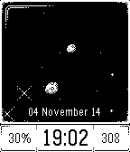
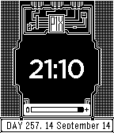

<!-- Generated by scripts/update_app_directory.py: do not edit by hand -->
[← All Pebble Developers](../developers.md)

# P1X

*3 watchfaces · Last updated 2026-10-12 · [About these lists](../about-app-lists.md)*

Links: [Pebble App Store](https://apps.repebble.com/apps/dev/p1x_5410171466e853e34100010f) · [GitHub (w84death)](https://github.com/w84death) · [Website (p1x.in)](http://p1x.in)

<button type="button" data-filter="all" aria-pressed="true">All 3</button><button type="button" data-filter="watchface" aria-pressed="false">Watchfaces 3</button><button type="button" data-filter="watchapp" aria-pressed="false" disabled>Apps 0</button>

<label class="dev-sort">Sort by <select><option value="updated">Recently updated</option><option value="released">Newest release</option><option value="title">A–Z</option></select></label>

<h2 class="app-name" id="app-54591fe85a7e52bd8b00007c"><a href="https://apps.repebble.com/54591fe85a7e52bd8b00007c">2001: Space Watch</a> v1.13</h2>
<a class="app-source" href="https://github.com/w84death/2001-space-watch" title="Source code" data-search-exclude>View source</a>

Watchface

Released 2014-11-04 Updated 2014-11-10

Runs on: Time 2, Pebble 2 Duo, Pebble 2, Time, Classic

*** Your own unique cosmos *** Practically infinite number of rich and fantastic backgrounds at each hour. You will never seen two identical backgrounds! Yes, that&#x27;s the power of procedural…

<h2 class="app-name" id="app-5415e8ce39b1c787430000b2"><a href="https://apps.repebble.com/5415e8ce39b1c787430000b2">2001: Wachface</a> v1.2</h2>
<a class="app-source" href="https://github.com/w84death/2001-Watchface" title="Source code" data-search-exclude>View source</a>

Watchface

Released 2014-09-14 Updated 2014-09-19

Runs on: Time 2, Pebble 2 Duo, Pebble 2, Time, Classic

Watchface promoting upcoming &quot;2001: A Space Shooter&quot; game for Pebble. Features: - neat pixel art - battery status - day of the year - full date Designed &amp; developed by P1X Indie Gamedev Studio…

<h2 class="app-name" id="app-54118b53bf4a28a2bd000146"><a href="https://apps.repebble.com/54118b53bf4a28a2bd000146">Time Is Limitless</a> v3</h2>
<a class="app-source" href="https://github.com/w84death/TimeIsLimitless" title="Source code" data-search-exclude>View source</a>

Watchface

Released 2014-09-11 Updated 2014-09-12

Runs on: Time 2, Pebble 2 Duo, Pebble 2, Time, Classic

This watch face do not show any time. It represents my philosophy of life that time does not matter. Dedicated to my girlfriend :) Features: - clean &amp; minimalistic look - gentle vibe every full…

