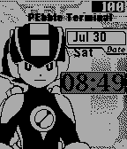
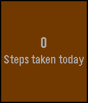

<!-- Generated by scripts/update_app_directory.py: do not edit by hand -->
[← All Pebble Developers](../developers.md)

# P1X3L

*1 watchface and 2 apps · Last updated 2026-10-12 · [About these lists](../about-app-lists.md)*

Links: [Pebble App Store](https://apps.repebble.com/apps/dev/p1x3l_56e01ef1320b57e74000000d) · [GitHub (BOBdotEXE)](https://github.com/BOBdotEXE) · [GitHub (pebble-examples)](https://github.com/pebble-examples) · [GitHub (pebble-hacks)](https://github.com/pebble-hacks)

<button type="button" data-filter="all" aria-pressed="true">All 3</button><button type="button" data-filter="watchface" aria-pressed="false">Watchfaces 1</button><button type="button" data-filter="watchapp" aria-pressed="false">Apps 2</button>

<label class="dev-sort">Sort by <select><option value="updated">Recently updated</option><option value="released">Newest release</option><option value="title">A–Z</option></select></label>

<h2 class="app-name" id="app-579d5b851482cd673b0003c9"><a href="https://apps.repebble.com/579d5b851482cd673b0003c9">Megaman PET</a> v1.3</h2>
<a class="app-source" href="https://github.com/BOBdotEXE/NaviEngine.git" title="Source code" data-search-exclude>View source</a>

Watchface

GPL-2.0 Released 2016-07-31 Updated 2016-08-09

Runs on: Time 2, Pebble 2 Duo, Pebble 2, Time, Classic

Your own Megaman NetNavi! This watchface is inspired and built of BOBdotEXE&#x27;s NetNavi watchface! I made a black and white version. The battery meter is at the top. The time animates when the…

<h2 class="app-name" id="app-5797ac0c5883b3374600010c"><a href="https://apps.repebble.com/5797ac0c5883b3374600010c">Steps</a> v1.0</h2>
<a class="app-source" href="https://github.com/pebble-examples/simple-health-example.git" title="Source code" data-search-exclude>View source</a>

App

Released 2016-07-26 Updated 2016-07-26

Runs on: Round 2, Time 2, Time Round, Time

This is a simple step counter for Time series Pebble&#x27;s! Hope you enjoy! If there are any issues feel free to email me! Opensource! Heart it!!!

<h2 class="app-name" id="app-578e6ae402f6d86ce30000b4"><a href="https://apps.repebble.com/578e6ae402f6d86ce30000b4">Building Blocks</a> v1.0</h2>
<a class="app-source" href="https://github.com/pebble-hacks/block-world.git" title="Source code" data-search-exclude>View source</a>

App

Released 2016-07-19 Updated 2016-07-19

Runs on: Round 2, Time 2, Time Round, Time

Building Blocks!!! This is a simple game that is uses blocks! (This is a WIP) How to play! Up - Switch axis through X, Y, Z and B (Block type) Down - Move through current axis Select - Place…

