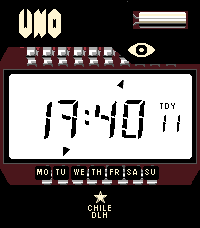

<!-- Generated by scripts/update_app_directory.py: do not edit by hand -->
[← All Pebble Developers](../developers.md)

# PableteFGA

*1 watchface · Last updated 2026-10-11 · [About these lists](../about-app-lists.md)*

Links: [Pebble App Store](https://apps.repebble.com/apps/dev/pabletefga_57087d31acc9c8eda96c7f4c) · [GitHub (PableteFGA)](https://github.com/PableteFGA)

<h2 class="app-name" id="app-205eaa19a4c145c39a62f383"><a href="https://apps.repebble.com/205eaa19a4c145c39a62f383">El número UNO</a> v1.1.0</h2>
<a class="app-source" href="https://github.com/PableteFGA/UNO-watchface" title="Source code" data-search-exclude>View source</a>

Watchface

No licence Released 2026-04-30 Updated 2026-08-11

Runs on: Round 2, Time 2, Pebble 2 Duo, Pebble 2, Time, Classic

El Número Uno para Pebble El Número Uno lleva el icónico aspecto del primer reloj digital de Chile a tu Pebble, recreando su carátula, dial transparente y segmentos numéricos originales. Incluye…

