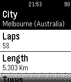

<!-- Generated by scripts/update_app_directory.py: do not edit by hand -->
[← All Pebble Developers](../developers.md)

# Pablo Séguin Llosá

*1 app · Last updated 2026-10-12 · [About these lists](../about-app-lists.md)*

Links: [Pebble App Store](https://apps.repebble.com/apps/dev/pablo-s-guin-llos_52f28cb488113476a3001720) · [GitHub (PabloLlosa)](https://github.com/PabloLlosa)

<h2 class="app-name" id="app-5339efd74eada6fede0000ef"><a href="https://apps.repebble.com/5339efd74eada6fede0000ef">Formula 1 2014</a> v1.0</h2>
<a class="app-source" href="https://github.com/PabloLlosa/FormulaOne2014Pebble" title="Source code" data-search-exclude>View source</a>

App

No licence Released 2014-03-31 Updated 2014-05-03

Runs on: Time 2, Pebble 2 Duo, Pebble 2, Time, Classic

Formula One 2014: Simple app to know all about this season Grand Prix. Coming soon: -Info about drivers. -Info about teams. -Live race results. -Much more.

