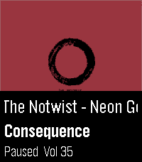

<!-- Generated by scripts/update_app_directory.py: do not edit by hand -->
[← All Pebble Developers](../developers.md)

# pagnotta

*1 app · Last updated 2026-10-11 · [About these lists](../about-app-lists.md)*

Links: [Pebble App Store](https://apps.repebble.com/apps/dev/pagnotta_68e2cbd07e5b5d7763ad27dd) · [GitHub (pagnotta)](https://github.com/pagnotta)

<h2 class="app-name" id="app-b1ff884434e84d3191c8bac2"><a href="https://apps.repebble.com/b1ff884434e84d3191c8bac2">Squeeze Lyrion LMS</a> v1.0.0</h2>
<a class="app-source" href="https://github.com/pagnotta/pebble-squeeze-lms" title="Source code" data-search-exclude>View source</a>

App · <a href="https://forum.rebble.io/t/1213" title="Discuss this app on the Rebble forum" data-search-exclude>Forum thread</a>

Released 2026-08-03 Updated 2026-08-03

Runs on: Round 2, Time 2

A native, touch-first remote for Squeezebox, squeezelite, and Lyrion Music Server — the server formerly known as Logitech Media Server (LMS) or SlimServer — tailored for the Pebble Time 2 and…

