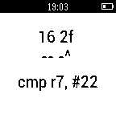

<!-- Generated by scripts/update_app_directory.py: do not edit by hand -->
[← All Pebble Developers](../developers.md)

# pancake

*1 app · Last updated 2026-10-12 · [About these lists](../about-app-lists.md)*

Links: [Pebble App Store](https://apps.repebble.com/apps/dev/pancake_547bd0724fa17fac1500009d) · [GitHub (radare)](https://github.com/radare)

<h2 class="app-name" id="app-55ccce0c203382e5ec000027"><a href="https://apps.repebble.com/55ccce0c203382e5ec000027">Thumb2 Disassembler</a> v1.0</h2>
<a class="app-source" href="https://github.com/radare/pebble-disthumb" title="Source code" data-search-exclude>View source</a>

App

Released 2015-08-13 Updated 2015-08-13

Runs on: Time 2, Pebble 2 Duo, Pebble 2, Time, Classic

This is an ARM Thumb2 disassembler tool that allows you to input some hexadecimal bytes and get the human readable instruction right there.

