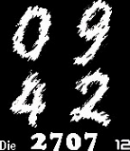

<!-- Generated by scripts/update_app_directory.py: do not edit by hand -->
[← All Pebble Developers](../developers.md)

# Paradox13

*1 watchface · Last updated 2026-10-12 · [About these lists](../about-app-lists.md)*

Links: [Pebble App Store](https://apps.repebble.com/apps/dev/paradox13_531b62da6b9bbe83a0000507) · [GitHub (grep-awesome)](https://github.com/grep-awesome)

<h2 class="app-name" id="app-53d4fd02dcc95d4def0001e9"><a href="https://apps.repebble.com/53d4fd02dcc95d4def0001e9">Spray revolution german</a> v2.0</h2>
<a class="app-source" href="https://github.com/grep-awesome/QuickTapPlus" title="Source code" data-search-exclude>View source</a>

Watchface

No licence Released 2014-07-27 Updated 2014-07-27

Runs on: Time 2, Pebble 2 Duo, Pebble 2, Time, Classic

Das ist ein MOD vom Revolution QT+,(Uhrzeitwechsel animiert) die Zahlen der Uhrzeit in Spraydosen-Spritzeffekt, Datum in runderer Form, Datum in Deutsch Schütteln zeigt, Bluetooth-Status…

