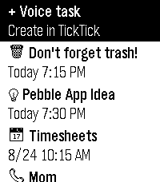

<!-- Generated by scripts/update_app_directory.py: do not edit by hand -->
[← All Pebble Developers](../developers.md)

# pascaloon

*1 app · Last updated 2026-10-12 · [About these lists](../about-app-lists.md)*

Links: [Pebble App Store](https://apps.repebble.com/apps/dev/pascaloon_52a58368eef8ac1adf511452) · [GitHub (pascaloon)](https://github.com/pascaloon)

<h2 class="app-name" id="app-21194297071144f9a9b946b1"><a href="https://apps.repebble.com/21194297071144f9a9b946b1">TickTick Timeline</a> v0.1.0</h2>
<a class="app-source" href="https://github.com/pascaloon/TickTickTimeline" title="Source code" data-search-exclude>View source</a>

App · <a href="https://forum.rebble.io/t/1273" title="Discuss this app on the Rebble forum" data-search-exclude>Forum thread</a>

Released 2026-08-23 Updated 2026-08-23

Runs on: Time 2

Unofficial TickTick integration for the Pebble Watch. This app is not affiliated with the official TickTick team. This is a community project because I love Pebble and I love TickTick! Key…

