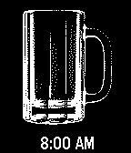

<!-- Generated by scripts/update_app_directory.py: do not edit by hand -->
[← All Pebble Developers](../developers.md)

# Patrick Crager

*1 watchface · Last updated 2026-10-12 · [About these lists](../about-app-lists.md)*

Links: [Pebble App Store](https://apps.repebble.com/apps/dev/patrick-crager_52bc40547e4312200c000142) · [GitHub (patch-e)](https://github.com/patch-e)

<h2 class="app-name" id="app-548be6a73987d6a62100007c"><a href="https://apps.repebble.com/548be6a73987d6a62100007c">Beer O&#x27;Clock</a> v1.1</h2>
<a class="app-source" href="https://github.com/patch-e/pebble-beer-o-clock-dx" title="Source code" data-search-exclude>View source</a>

Watchface

Released 2014-12-13 Updated 2014-12-14

Runs on: Time 2, Pebble 2 Duo, Pebble 2, Time, Classic

A silly watchface featuring a beer mug that fills from 9am until Beer O&#x27;Clock (aka 5pm). This is a port of a Pebble 1.0 firmware watchface written by ThomW (http://www.lmnopc.com/) to be…

