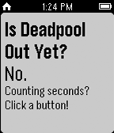

<!-- Generated by scripts/update_app_directory.py: do not edit by hand -->
[← All Pebble Developers](../developers.md)

# Patrick Teglia

*1 app · Last updated 2026-10-12 · [About these lists](../about-app-lists.md)*

Links: [Pebble App Store](https://apps.repebble.com/apps/dev/patrick-teglia_557f8130e512e3e392000089) · [GitHub (teglia)](https://github.com/teglia) · [Website (isdeadpooloutyet.com)](http://isdeadpooloutyet.com)

<h2 class="app-name" id="app-55f3c813f4177db70e00005c"><a href="https://apps.repebble.com/55f3c813f4177db70e00005c">Is Deadpool Out Yet?</a> v1.2</h2>
<a class="app-source" href="https://github.com/teglia/isdeadpooloutyet/tree/pebble-develop" title="Source code" data-search-exclude>View source</a>

App

Released 2015-09-12 Updated 2015-09-14

Runs on: Time 2, Pebble 2 Duo, Pebble 2, Time, Classic

Is Deadpool out yet? You won&#x27;t know until you put this on your watch!

