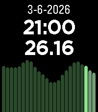

<!-- Generated by scripts/update_app_directory.py: do not edit by hand -->
[← All Pebble Developers](../developers.md)

# Patrick van Beem

*1 app · Last updated 2026-10-12 · [About these lists](../about-app-lists.md)*

Links: [Pebble App Store](https://apps.repebble.com/apps/dev/patrick-van-beem_6956e4df658abd0009484f11) · [GitHub (patrickvbe)](https://github.com/patrickvbe)

<h2 class="app-name" id="app-6962ad396da27100081c4c25"><a href="https://apps.repebble.com/6962ad396da27100081c4c25">Energy Tariffs</a> v1.1.1</h2>
<a class="app-source" href="https://github.com/patrickvbe/Pebble-EnergyTariffs" title="Source code" data-search-exclude>View source</a>

App · <a href="https://forum.rebble.io/t/475" title="Discuss this app on the Rebble forum" data-search-exclude>Forum thread</a>

Released 2026-01-10 Updated 2026-06-27

Runs on: Round 2, Time 2, Pebble 2 Duo, Pebble 2, Time Round, Time, Classic

Displays dynamic energy tariffs on the Pebble watch. Currently, only Dutch tariffs are supported (like Zonneplan and Tibber) and only in hourly rates (I think the quarterly rates are only useful…

