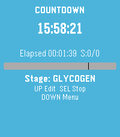
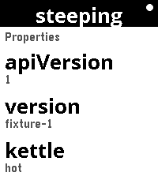

<!-- Generated by scripts/update_app_directory.py: do not edit by hand -->
[← All Pebble Developers](../developers.md)

# Paul Bütow

*2 apps · Last updated 2026-10-11 · [About these lists](../about-app-lists.md)*

Links: [Pebble App Store](https://apps.repebble.com/apps/dev/paul-b-tow_879658cff76b318b7b31f6af) · [GitHub (snonux)](https://github.com/snonux)

<button type="button" data-filter="all" aria-pressed="true">All 2</button><button type="button" data-filter="watchface" aria-pressed="false" disabled>Watchfaces 0</button><button type="button" data-filter="watchapp" aria-pressed="false">Apps 2</button>

<label class="dev-sort">Sort by <select><option value="updated">Recently updated</option><option value="released">Newest release</option><option value="title">A–Z</option></select></label>

<h2 class="app-name" id="app-a488436292ad4eb69d2a61d8"><a href="https://apps.repebble.com/a488436292ad4eb69d2a61d8">FastForge</a> v1.6</h2>
<a class="app-source" href="https://github.com/snonux/fastforge" title="Source code" data-search-exclude>View source</a>

App

Released 2026-04-15 Updated 2026-09-10

Runs on: Round 2, Time 2

Track intermittent fasting from your wrist. Start and monitor fasts with a clear timer, use quick presets for common schedules, and review history and streak-friendly stats when you need context…

<h2 class="app-name" id="app-931683527605431e96bf2772"><a href="https://apps.repebble.com/931683527605431e96bf2772">RESTForge</a> v0.6</h2>
<a class="app-source" href="https://github.com/snonux/restforge" title="Source code" data-search-exclude>View source</a>

App

Released 2026-08-19 Updated 2026-08-19

Runs on: Round 2, Time 2

RESTForge — control any Siren API from your wrist RESTForge turns your Pebble into a remote control for any web API that speaks Siren — a standard way for a server to describe itself. You don&#x27;t…

