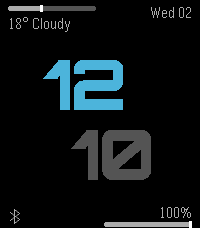
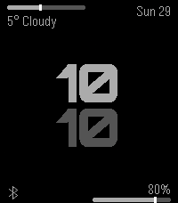
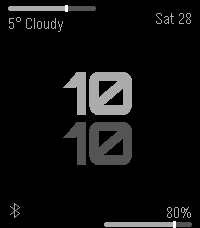
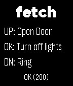

<!-- Generated by scripts/update_app_directory.py: do not edit by hand -->
[← All Pebble Developers](../developers.md)

# paul3m

*4 watchfaces and 1 app · Last updated 2026-10-11 · [About these lists](../about-app-lists.md)*

Links: [Pebble App Store](https://apps.repebble.com/apps/dev/paul3m_27ef9d2ded8279c429fce882) · [GitHub (paul-em)](https://github.com/paul-em)

<button type="button" data-filter="all" aria-pressed="true">All 5</button><button type="button" data-filter="watchface" aria-pressed="false">Watchfaces 4</button><button type="button" data-filter="watchapp" aria-pressed="false">Apps 1</button>

<label class="dev-sort">Sort by <select><option value="updated">Recently updated</option><option value="released">Newest release</option><option value="title">A–Z</option></select></label>

<h2 class="app-name" id="app-2a378472017a4c0098b0e7d9"><a href="https://apps.repebble.com/2a378472017a4c0098b0e7d9">emFace</a> v1.5.0</h2>
<a class="app-source" href="https://github.com/paul-em/pebble-emFace" title="Source code" data-search-exclude>View source</a>

Watchface

Released 2026-09-02 Updated 2026-09-02

Runs on: Round 2, Time 2, Pebble 2 Duo, Pebble 2, Time Round, Time, Classic

Watch face that shows information on 4 corners: Top left: Weather info with bar indicating the max/min temperature of the day and where we are in this range right now Top right: Date Bottom left…

<h2 class="app-name" id="app-a34e76c10ab94a2a9235b6d8"><a href="https://apps.repebble.com/a34e76c10ab94a2a9235b6d8">emFace</a> v1.3</h2>
<a class="app-source" href="https://github.com/paul-em/pebble-emFace" title="Source code" data-search-exclude>View source</a>

Watchface

Released 2026-03-29 Updated 2026-03-29

Runs on: Round 2, Time 2, Pebble 2 Duo, Pebble 2, Time Round, Time, Classic

Watch face that shows information on 4 corners: Top left: Weather info with bar indicating the max/min temperature of the day and where we are in this range right now Top right: Date Bottom left…

<h2 class="app-name" id="app-429e6ee5ab3b4c9b9313058c"><a href="https://apps.repebble.com/429e6ee5ab3b4c9b9313058c">emFace</a> v1.2</h2>
<a class="app-source" href="https://github.com/paul-em/pebble-emFace" title="Source code" data-search-exclude>View source</a>

Watchface

Released 2026-03-28 Updated 2026-03-28

Runs on: Round 2, Time 2, Pebble 2 Duo, Pebble 2, Time Round, Time, Classic

Watch face that shows information on 4 corners: Top left: Weather info with bar indicating the max/min temperature of the day and where we are in this range right now Top right: Date Bottom left…

<h2 class="app-name" id="app-4b9bac75f03745dcb4d86f25"><a href="https://apps.repebble.com/4b9bac75f03745dcb4d86f25">Android Pixel</a> v1.1</h2>
<a class="app-source" href="https://github.com/paul-em/pebble-android-watchface" title="Source code" data-search-exclude>View source</a>

Watchface

Released 2026-03-26 Updated 2026-03-26

Runs on: Round 2, Time 2, Pebble 2 Duo, Pebble 2, Time Round, Time, Classic

Currently mainly built for Pebble 2 Duo. Pebble Time 2 optimizations will follow

<h2 class="app-name" id="app-abb6d785901941a3810f7dc4"><a href="https://apps.repebble.com/abb6d785901941a3810f7dc4">fetch</a> v1.1</h2>
<a class="app-source" href="https://github.com/paul-em/pebble-fetch" title="Source code" data-search-exclude>View source</a>

App

Released 2026-03-24 Updated 2026-03-25

Runs on: Round 2, Time 2, Pebble 2 Duo, Pebble 2, Time Round, Time, Classic

Send http requests from your watch! Includes config options for up to 3 quick access requests with methods GET POST PUT DELTE PATCH and custom headers

