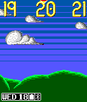

<!-- Generated by scripts/update_app_directory.py: do not edit by hand -->
[← All Pebble Developers](../developers.md)

# paulguy

*1 watchface · Last updated 2026-10-11 · [About these lists](../about-app-lists.md)*

Links: [Pebble App Store](https://apps.repebble.com/apps/dev/paulguy_5589d8e092e32b62ba000016) · [GitHub (paulguy)](https://github.com/paulguy)

<h2 class="app-name" id="app-5648232eb2013f2279000040"><a href="https://apps.repebble.com/5648232eb2013f2279000040">Sprite Scroller</a> v1.3</h2>
<a class="app-source" href="https://github.com/paulguy/Sprite-Scroller" title="Source code" data-search-exclude>View source</a>

Watchface

Released 2015-11-15 Updated 2015-11-19

Runs on: Time 2, Time

Displays time of day as a continuously scrolling landscape made up of small sprites. The sky changes color for different times of day. Visually plain now, but plans for more details and decoration…

