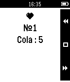

<!-- Generated by scripts/update_app_directory.py: do not edit by hand -->
[← All Pebble Developers](../developers.md)

# Pavel Tsybulin

*1 app · Last updated 2026-10-12 · [About these lists](../about-app-lists.md)*

Links: [Rebble App Store](https://apps.rebble.io/en_US/developer/5364a921668e019e1a000162/1) · [GitHub (tsybulin)](https://github.com/tsybulin) · [Website (papasha.kiev.ua)](http://papasha.kiev.ua/gs/en/)

<h2 class="app-name" id="app-553910898ee8449913000005"><a href="https://apps.rebble.io/en_US/application/553910898ee8449913000005">Go Shopping!</a> v1.1</h2>
<a class="app-source" href="https://github.com/tsybulin/pebble-goshopping" title="Source code" data-search-exclude>View source</a>

App

Released 2015-04-23 Updated 2015-05-14 Rebble App Store

Runs on: Time 2, Pebble 2 Duo, Pebble 2, Time, Classic

Companion app, which allows you to display and manage the current grocery list.

