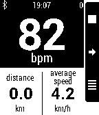

<!-- Generated by scripts/update_app_directory.py: do not edit by hand -->
[← All Pebble Developers](../developers.md)

# Pebble Bike

*1 app · Last updated 2026-10-11 · [About these lists](../about-app-lists.md)*

Links: [Pebble App Store](https://apps.repebble.com/apps/dev/pebble-bike_528d06f11fdcc0ebd7000006) · [GitHub (pebble-bike)](https://github.com/pebble-bike) · [Website (pebblebike.com)](http://www.pebblebike.com/)

<h2 class="app-name" id="app-529289cee07df1fa76000009"><a href="https://apps.repebble.com/529289cee07df1fa76000009">Ventoo - GPS sports tracker</a> v2.91</h2>
<a class="app-source" href="https://github.com/pebble-bike/PebbleBike-AndroidApp" title="Source code" data-search-exclude>View source</a>

App

Released 2013-11-24 Updated 2017-07-22

Runs on: Round 2, Time 2, Pebble 2 Duo, Pebble 2, Time Round, Time, Classic

(formerly known as Pebble Bike) Ventoo is a GPS sports tracker for your Pebble. It uses your phone&#x27;s GPS to send speed, distance and altitude data to your Pebble. You can automatically upload your…

