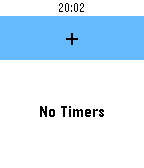
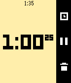
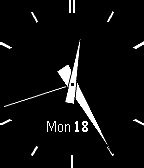
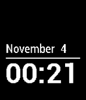
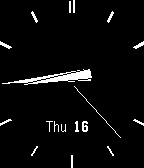
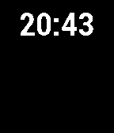
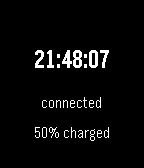
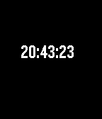

<!-- Generated by scripts/update_app_directory.py: do not edit by hand -->
[← All Pebble Developers](../developers.md)

# Pebble

*18 watchfaces and 3 apps · Last updated 2026-10-12 · [About these lists](../about-app-lists.md)*

Links: [Pebble App Store](https://apps.repebble.com/apps/dev/pebble_52d8a44faef8d590d3000029) · [GitHub (pebble)](https://github.com/pebble) · [GitHub (coredevices)](https://github.com/coredevices) · [GitHub (pebble-hacks)](https://github.com/pebble-hacks) · [GitHub (pebble-examples)](https://github.com/pebble-examples) · [Website (getpebble.com)](https://getpebble.com)

<button type="button" data-filter="all" aria-pressed="true">All 21</button><button type="button" data-filter="watchface" aria-pressed="false">Watchfaces 18</button><button type="button" data-filter="watchapp" aria-pressed="false">Apps 3</button>

<label class="dev-sort">Sort by <select><option value="updated">Recently updated</option><option value="released">Newest release</option><option value="title">A–Z</option></select></label>

<h2 class="app-name" id="app-55b6cd955e0716cd6b0000a1"><a href="https://apps.repebble.com/55b6cd955e0716cd6b0000a1">Timer</a> v1.2.7</h2>
<a class="app-source" href="https://github.com/coredevices/pebble-timer" title="Source code" data-search-exclude>View source</a>

App

No licence Released 2015-07-28 Updated 2026-10-02

Runs on: Round 2, Time 2, Pebble 2 Duo, Pebble 2, Time Round, Time, Classic

Pebble&#x27;s first official timer! Set up to eight different timers and watch them run down. Timers longer than fifteen minutes also push a pin to your timeline.

<h2 class="app-name" id="app-540f7cafbc27450164000157"><a href="https://apps.repebble.com/540f7cafbc27450164000157">Compass</a> v1.31</h2>
<a class="app-source" href="https://github.com/coredevices/pebble-compass" title="Source code" data-search-exclude>View source</a>

App

No licence Released 2014-09-09 Updated 2026-07-27

Runs on: Round 2, Time 2, Pebble 2 Duo, Pebble 2, Time Round, Time, Classic

Compass app elegantly animates between two different modes: A compass rose when you look down at your Pebble and a heading indicator when hold the watch in front of the horizon. A spirit level is…

<h2 class="app-name" id="app-555a3ce1c2afa28d5800000f"><a href="https://apps.repebble.com/555a3ce1c2afa28d5800000f">Sliding Text</a> v1.2.1</h2>
<a class="app-source" href="https://github.com/coredevices/sliding-text" title="Source code" data-search-exclude>View source</a>

Watchface

MIT Released 2015-05-18 Updated 2026-05-03

Runs on: Round 2, Time 2, Pebble 2 Duo, Pebble 2, Time Round, Time, Classic

The classic Pebble watchface!

<h2 class="app-name" id="app-55b6c2c3e68f5acdfc00008d"><a href="https://apps.repebble.com/55b6c2c3e68f5acdfc00008d">Stopwatch</a> v1.3.0</h2>
<a class="app-source" href="https://github.com/coredevices/pebble-stopwatch" title="Source code" data-search-exclude>View source</a>

App

No licence Released 2015-07-27 Updated 2026-04-04

Runs on: Round 2, Time 2, Pebble 2 Duo, Pebble 2, Time Round, Time, Classic

Time anything you wish with Pebble&#x27;s beautifully simple stopwatch app! It runs in the background and can hold up to twenty laps.

<h2 class="app-name" id="app-555a3c55c2afa2329c000006"><a href="https://apps.repebble.com/555a3c55c2afa2329c000006">Simple Analog</a> v1.2</h2>
<a class="app-source" href="https://github.com/pebble-examples/simple-analog" title="Source code" data-search-exclude>View source</a>

Watchface

Released 2015-05-18 Updated 2015-12-14

Runs on: Round 2, Time 2, Pebble 2 Duo, Pebble 2, Time Round, Time, Classic

The classic watchface for Pebble and Pebble Steel.

<h2 class="app-name" id="app-555a3b03ae067ddac1000014"><a href="https://apps.repebble.com/555a3b03ae067ddac1000014">Simplicity</a> v3.2</h2>
<a class="app-source" href="https://github.com/pebble-examples/simplicity" title="Source code" data-search-exclude>View source</a>

Watchface

Released 2015-05-18 Updated 2015-12-12

Runs on: Round 2, Time 2, Pebble 2 Duo, Pebble 2, Time Round, Time, Classic

The classic built-in watchface for Pebble and Pebble Steel.

<h2 class="app-name" id="app-539b9c9edf7043397300004b"><a href="https://apps.repebble.com/539b9c9edf7043397300004b">Sports</a> v1.0.0</h2>
<a class="app-source" href="https://github.com/pebble-hacks/lukasz-projects/tree/master/sports" title="Source code" data-search-exclude>View source</a>

Watchface

Released 2014-06-14 Updated 2014-06-14

Runs on: Time 2, Pebble 2 Duo, Pebble 2, Time, Classic

Yahoo Sports RSS feeds on your wrist! Choose your favourite feeds from &#x27;Settings&#x27; menu including World Soccer, MLB, NASCAR, and more! Adjust news update interval time and enjoy latest headline at…

<h2 class="app-name" id="app-539b91cd199eae1e870000ab"><a href="https://apps.repebble.com/539b91cd199eae1e870000ab">Grid Lite</a> v1.0.0</h2>
<a class="app-source" href="https://github.com/pebble-hacks/lukasz-projects/tree/master/gridlite" title="Source code" data-search-exclude>View source</a>

Watchface

Released 2014-06-14 Updated 2014-06-14

Runs on: Time 2, Pebble 2 Duo, Pebble 2, Time, Classic

Grid style watchface

<h2 class="app-name" id="app-539b982ddf322d33870000ad"><a href="https://apps.repebble.com/539b982ddf322d33870000ad">Grid Father&#x27;s Day Edition</a> v1.0.0</h2>
<a class="app-source" href="https://github.com/pebble-hacks/lukasz-projects/tree/master/griddad" title="Source code" data-search-exclude>View source</a>

Watchface

Released 2014-06-14 Updated 2014-06-14

Runs on: Time 2, Pebble 2 Duo, Pebble 2, Time, Classic

A special edition of the Grid Lite watchface to celebrate Father&#x27;s Day. Shake the Pebble for the hidden message. Share the watchface with the Pebble dads in your life!

<h2 class="app-name" id="app-52e2de2afaa843cafe000d70"><a href="https://apps.repebble.com/52e2de2afaa843cafe000d70">Brains</a> v1.0.0</h2>
<a class="app-source" href="https://github.com/pebble/pebble-sdk-examples/tree/master/watchfaces/brains" title="Source code" data-search-exclude>View source</a>

Watchface

Released 2014-01-24 Updated 2014-01-24

Runs on: Time 2, Pebble 2 Duo, Pebble 2, Time, Classic

Brains watchface example SDK 2.0 migration by Max Baumle

<h2 class="app-name" id="app-52d8b9d7aef8d50e88000026"><a href="https://apps.repebble.com/52d8b9d7aef8d50e88000026">Tic Tock Toe</a> v4.0.0</h2>
<a class="app-source" href="https://github.com/pebble/pebble-sdk-examples/tree/master/watchfaces/tic_tock_toe" title="Source code" data-search-exclude>View source</a>

Watchface

Released 2014-01-17 Updated 2014-01-17

Runs on: Time 2, Pebble 2 Duo, Pebble 2, Time, Classic

Tic Toc Toe Example Watchface

<h2 class="app-name" id="app-52d8bc1daef8d50e88000029"><a href="https://apps.repebble.com/52d8bc1daef8d50e88000029">Simple Analog</a> v1.0.0</h2>
<a class="app-source" href="https://github.com/pebble/pebble-sdk-examples/tree/master/watchfaces/simple_analog" title="Source code" data-search-exclude>View source</a>

Watchface

Released 2014-01-17 Updated 2014-01-17

Runs on: Time 2, Pebble 2 Duo, Pebble 2, Time, Classic

Simple Analog Example Watchface

<h2 class="app-name" id="app-52d8bbeb1acbf3738d000030"><a href="https://apps.repebble.com/52d8bbeb1acbf3738d000030">Segment Six</a> v2.0.0</h2>
<a class="app-source" href="https://github.com/pebble/pebble-sdk-examples/tree/master/watchfaces/segment_six" title="Source code" data-search-exclude>View source</a>

Watchface

Released 2014-01-17 Updated 2014-01-17

Runs on: Time 2, Pebble 2 Duo, Pebble 2, Time, Classic

Segment Six Example Watchface

<h2 class="app-name" id="app-52d8bbb0aef8d5c2cd00003d"><a href="https://apps.repebble.com/52d8bbb0aef8d5c2cd00003d">Rumble Time</a> v2.0.0</h2>
<a class="app-source" href="https://github.com/pebble/pebble-sdk-examples/tree/master/watchfaces/rumbletime" title="Source code" data-search-exclude>View source</a>

Watchface

Released 2014-01-17 Updated 2014-01-17

Runs on: Time 2, Pebble 2 Duo, Pebble 2, Time, Classic

Rumble Time Example Watchface

<h2 class="app-name" id="app-52d8bb781acbf3738d00002f"><a href="https://apps.repebble.com/52d8bb781acbf3738d00002f">On the Button</a> v3.0</h2>
<a class="app-source" href="https://github.com/pebble/pebble-sdk-examples/tree/master/watchfaces/onthebutton" title="Source code" data-search-exclude>View source</a>

Watchface

Released 2014-01-17 Updated 2014-01-17

Runs on: Time 2, Pebble 2 Duo, Pebble 2, Time, Classic

On the Button Example Watchface

<h2 class="app-name" id="app-52d8bb0faef8d590d300002f"><a href="https://apps.repebble.com/52d8bb0faef8d590d300002f">Just a Bit</a> v4.0.0</h2>
<a class="app-source" href="https://github.com/pebble/pebble-sdk-examples/tree/master/watchfaces/just_a_bit" title="Source code" data-search-exclude>View source</a>

Watchface

Released 2014-01-17 Updated 2014-01-17

Runs on: Time 2, Pebble 2 Duo, Pebble 2, Time, Classic

Just a Bit Example Watchface

<h2 class="app-name" id="app-52d8bad9aef8d5b107000027"><a href="https://apps.repebble.com/52d8bad9aef8d5b107000027">Fuzzy Time</a> v1.0.0</h2>
<a class="app-source" href="https://github.com/pebble/pebble-sdk-examples/tree/master/watchfaces/fuzzy_time" title="Source code" data-search-exclude>View source</a>

Watchface

Released 2014-01-17 Updated 2014-01-17

Runs on: Time 2, Pebble 2 Duo, Pebble 2, Time, Classic

Fuzzy Time Example Watchface

<h2 class="app-name" id="app-52d8baa3aef8d5b107000026"><a href="https://apps.repebble.com/52d8baa3aef8d5b107000026">Drop Zone</a> v2.0.0</h2>
<a class="app-source" href="https://github.com/pebble/pebble-sdk-examples/tree/master/watchfaces/drop_zone" title="Source code" data-search-exclude>View source</a>

Watchface

Released 2014-01-17 Updated 2014-01-17

Runs on: Time 2, Pebble 2 Duo, Pebble 2, Time, Classic

Drop Zone Example Watchface

<h2 class="app-name" id="app-52d8ba2baef8d590d300002c"><a href="https://apps.repebble.com/52d8ba2baef8d590d300002c">ClassIO Battery Connection</a> v2.0.0</h2>
<a class="app-source" href="https://github.com/pebble/pebble-sdk-examples/tree/master/watchfaces/classio-battery-connection" title="Source code" data-search-exclude>View source</a>

Watchface

Released 2014-01-17 Updated 2014-01-17

Runs on: Time 2, Pebble 2 Duo, Pebble 2, Time, Classic

ClassIO Battery Connection

<h2 class="app-name" id="app-52d8ba68aef8d50e88000027"><a href="https://apps.repebble.com/52d8ba68aef8d50e88000027">Classio</a> v2.0.0</h2>
<a class="app-source" href="https://github.com/pebble/pebble-sdk-examples/tree/master/watchfaces/classio" title="Source code" data-search-exclude>View source</a>

Watchface

Released 2014-01-17 Updated 2014-01-17

Runs on: Time 2, Pebble 2 Duo, Pebble 2, Time, Classic

Classio Example Watchface

<h2 class="app-name" id="app-52d8b3240bab47f4d5000021"><a href="https://apps.repebble.com/52d8b3240bab47f4d5000021">Big Time</a> v6.0.0</h2>
<a class="app-source" href="https://github.com/pebble/pebble-sdk-examples/tree/master/watchfaces/big_time" title="Source code" data-search-exclude>View source</a>

Watchface

Released 2014-01-17 Updated 2014-01-17

Runs on: Time 2, Pebble 2 Duo, Pebble 2, Time, Classic

Big Time Watchface

