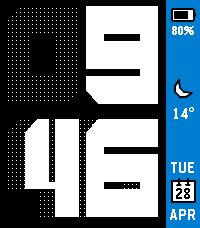

<!-- Generated by scripts/update_app_directory.py: do not edit by hand -->
[← All Pebble Developers](../developers.md)

# PebbleYYC

*1 watchface · Last updated 2026-10-11 · [About these lists](../about-app-lists.md)*

Links: [Pebble App Store](https://apps.repebble.com/apps/dev/pebbleyyc_6bb571fd353314a1f27645ea) · [GitHub (PebbleYYC)](https://github.com/PebbleYYC)

<h2 class="app-name" id="app-8cd850ae97844eaa98e94e2e"><a href="https://apps.repebble.com/8cd850ae97844eaa98e94e2e">BrutalTimeStyle</a> v1.3</h2>
<a class="app-source" href="https://www.github.com/PebbleYYC/BrutalTimeStyle" title="Source code" data-search-exclude>View source</a>

Watchface · <a href="https://forum.rebble.io/t/928" title="Discuss this app on the Rebble forum" data-search-exclude>Forum thread</a>

Released 2026-04-29 Updated 2026-05-04

Runs on: Time 2, Time

This is just a combination of two of my favourite watchfaces: Timestyle (by Freakified) and Brutal (by Irek). ALL credit actually goes to them. I&#x27;ve loved using this, and thought I&#x27;d share. If I&#x27;m…

