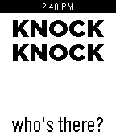
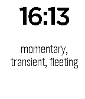

<!-- Generated by scripts/update_app_directory.py: do not edit by hand -->
[← All Pebble Developers](../developers.md)

# PebbLiz Technologies

*1 watchface and 2 apps · Last updated 2026-10-12 · [About these lists](../about-app-lists.md)*

Links: [Pebble App Store](https://apps.repebble.com/apps/dev/pebbliz-technologies_52b776ad9efe582fb2000002) · [GitHub (pouves)](https://github.com/pouves) · [GitHub (pebble-hacks)](https://github.com/pebble-hacks)

<button type="button" data-filter="all" aria-pressed="true">All 3</button><button type="button" data-filter="watchface" aria-pressed="false">Watchfaces 1</button><button type="button" data-filter="watchapp" aria-pressed="false">Apps 2</button>

<label class="dev-sort">Sort by <select><option value="updated">Recently updated</option><option value="released">Newest release</option><option value="title">A–Z</option></select></label>

<h2 class="app-name" id="app-53439874b32bb7bda9000070"><a href="https://apps.repebble.com/53439874b32bb7bda9000070">Knock Knock</a> v1.0</h2>
<a class="app-source" href="https://github.com/pouves/Knock-Knock" title="Source code" data-search-exclude>View source</a>

App

Released 2014-04-08 Updated 2014-05-20

Runs on: Time 2, Pebble 2 Duo, Pebble 2, Time, Classic

Knock-knock jokes! (version 2.0...double the jokes!) Make a knocking motion with your hand to generate a joke...push the down button for the punchline! (Jokes are suitable for all ages) Have a…

<h2 class="app-name" id="app-5344d1cd40f5878be800019e"><a href="https://apps.repebble.com/5344d1cd40f5878be800019e">W&amp;L: Vocabulary</a> v1.0.0</h2>
<a class="app-source" href="https://github.com/pouves/Watch_and_Learn_Vocabulary" title="Source code" data-search-exclude>View source</a>

App

Released 2014-04-09 Updated 2014-04-09

Runs on: Time 2, Pebble 2 Duo, Pebble 2, Time, Classic

Watch &amp; Learn Flashcards show vocabulary words. Want to add your own content? Website linked below includes easy-to-follow directions! A flick of the wrist or pressing &quot;select&quot; turns the card to…

<h2 class="app-name" id="app-52b786db9efe58231f000006"><a href="https://apps.repebble.com/52b786db9efe58231f000006">W&amp;L Amino Acids</a> v1.0.0</h2>
<a class="app-source" href="https://github.com/pebble-hacks/watch_and_learn" title="Source code" data-search-exclude>View source</a>

Watchface

Released 2013-12-23 Updated 2014-01-08

Runs on: Time 2, Pebble 2 Duo, Pebble 2, Time, Classic

Watch &amp; Learn Flashcards show the structures of the 20 common amino acids and their 1-letter code on the front. A flick of the wrist turns the card to the back, showing the name, 3-letter code…

