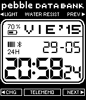
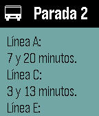
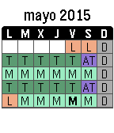
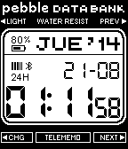

<!-- Generated by scripts/update_app_directory.py: do not edit by hand -->
[← All Pebble Developers](../developers.md)

# Pedro

*2 watchfaces and 2 apps · Last updated 2026-10-11 · [About these lists](../about-app-lists.md)*

Links: [Pebble App Store](https://apps.repebble.com/apps/dev/pedro_535907fa2acb26c7e50001b1) · [GitHub (pjexposito)](https://github.com/pjexposito)

<button type="button" data-filter="all" aria-pressed="true">All 4</button><button type="button" data-filter="watchface" aria-pressed="false">Watchfaces 2</button><button type="button" data-filter="watchapp" aria-pressed="false">Apps 2</button>

<label class="dev-sort">Sort by <select><option value="updated">Recently updated</option><option value="released">Newest release</option><option value="title">A–Z</option></select></label>

<h2 class="app-name" id="app-540888f892ecf49ebe000106"><a href="https://apps.repebble.com/540888f892ecf49ebe000106">DB 31</a> v2.6</h2>
<a class="app-source" href="http://www.github.com/pjexposito/DB31" title="Source code" data-search-exclude>View source</a>

Watchface

No licence Released 2014-09-04 Updated 2016-11-07

Runs on: Time 2, Pebble 2 Duo, Pebble 2, Time, Classic

Watchface based on Casio Data Bank 31. All the watchface code (almost everything) is taken from 91 Dub watchface (maybe the best watchface on Pebble Store). So this is my little contribution. Now…

<h2 class="app-name" id="app-54033440377c7ea48500005c"><a href="https://apps.repebble.com/54033440377c7ea48500005c">Bus Elche</a> v2.1</h2>
<a class="app-source" href="https://github.com/pjexposito/buselche" title="Source code" data-search-exclude>View source</a>

App

Released 2014-08-31 Updated 2016-03-14

Runs on: Time 2, Pebble 2 Duo, Pebble 2, Time, Classic

Programa para conocer el tiempo que tardan en llegar a las paradas los autobuses de Elche. Permite guardar paradas favoritas manteniendo el botón de selección pulsado durante más de 3 segundos…

<h2 class="app-name" id="app-54bb83cb4de463ab52000014"><a href="https://apps.repebble.com/54bb83cb4de463ab52000014">ECI Toolbox</a> v1.42</h2>
<a class="app-source" href="https://github.com/pjexposito/ECIToolbox" title="Source code" data-search-exclude>View source</a>

App

Released 2015-01-18 Updated 2016-01-08

Runs on: Time 2, Pebble 2 Duo, Pebble 2, Time, Classic

Versión en color.

<h2 class="app-name" id="app-53f52c9e5586fb3a4d00002f"><a href="https://apps.repebble.com/53f52c9e5586fb3a4d00002f">DB 31 (español)</a> v1</h2>
<a class="app-source" href="https://github.com/pjexposito/DB31-original" title="Source code" data-search-exclude>View source</a>

Watchface

Released 2014-08-20 Updated 2014-08-20

Runs on: Time 2, Pebble 2 Duo, Pebble 2, Time, Classic

Versión desactualizada. Se recomienda usar la versión DB 31 normal. Esta versión no tiene soporte y ha perdido funcionalidad. Esta nueva versión permite cambiar el idioma y varias cosas más. Por…

