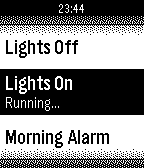

<!-- Generated by scripts/update_app_directory.py: do not edit by hand -->
[← All Pebble Developers](../developers.md)

# PeopleTech

*1 app · Last updated 2026-10-12 · [About these lists](../about-app-lists.md)*

Links: [Pebble App Store](https://apps.repebble.com/apps/dev/peopletech_52f057c1a0cb6aa63500142b) · [GitHub (drewying)](https://github.com/drewying)

<h2 class="app-name" id="app-52f47ee73f5d46cf5c00050b"><a href="https://apps.repebble.com/52f47ee73f5d46cf5c00050b">Vera Scenes</a> v1.0.0</h2>
<a class="app-source" href="https://github.com/drewying/VeraPebble" title="Source code" data-search-exclude>View source</a>

App

MIT Released 2014-02-07 Updated 2014-02-07

Runs on: Time 2, Pebble 2 Duo, Pebble 2, Time, Classic

Control your micasaverde Vera unit from your Pebble Watch! This allows you to browse through all Vera scenes as well as run them.

