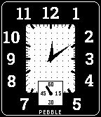

<!-- Generated by scripts/update_app_directory.py: do not edit by hand -->
[← All Pebble Developers](../developers.md)

# peroumal1

*1 watchface · Last updated 2026-10-12 · [About these lists](../about-app-lists.md)*

Links: [Pebble App Store](https://apps.repebble.com/apps/dev/peroumal1_a32710a0e38325e24c3b7e69) · [GitHub (peroumal1)](https://github.com/peroumal1)

<h2 class="app-name" id="app-f4040223d6df4dd7b1d6456f"><a href="https://apps.repebble.com/f4040223d6df4dd7b1d6456f">Reverble</a> v1.0.1</h2>
<a class="app-source" href="https://github.com/peroumal1/reverble-watchface" title="Source code" data-search-exclude>View source</a>

Watchface

Released 2026-09-12 Updated 2026-09-12

Runs on: Pebble 2 Duo

A minimalist rectangular analog watchface with a textured dial, railway-style minute track, and a running-seconds subdial. Includes a color-invert mode that flips black and white across the whole…

