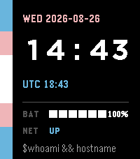

<!-- Generated by scripts/update_app_directory.py: do not edit by hand -->
[← All Pebble Developers](../developers.md)

# Perpetual Chaos

*2 watchfaces · Last updated 2026-10-12 · [About these lists](../about-app-lists.md)*

Links: [Pebble App Store](https://apps.repebble.com/apps/dev/perpetual-chaos_dafb87e5b9ba2725653a8e81) · [GitHub (JuiceBoxYum)](https://github.com/JuiceBoxYum)

<button type="button" data-filter="all" aria-pressed="true">All 2</button><button type="button" data-filter="watchface" aria-pressed="false">Watchfaces 2</button><button type="button" data-filter="watchapp" aria-pressed="false" disabled>Apps 0</button>

<label class="dev-sort">Sort by <select><option value="updated">Recently updated</option><option value="released">Newest release</option><option value="title">A–Z</option></select></label>

<h2 class="app-name" id="app-3081f89db28a48c29f20ff82"><a href="https://apps.repebble.com/3081f89db28a48c29f20ff82">Tutorial Watchface</a> v1.0.0</h2>
<a class="app-source" href="https://github.com/JuiceBoxYum/RedTeamFace" title="Source code" data-search-exclude>View source</a>

Watchface

No licence Released 2026-08-27 Updated 2026-08-27

Runs on: Round 2, Time 2

A red team/nerdy watch face for pebble time 2.

<h2 class="app-name" id="app-a13768d6e60542b485a3c83d"><a href="https://apps.repebble.com/a13768d6e60542b485a3c83d">Subtle Trans Time</a> v1.0.1</h2>
<a class="app-source" href="https://github.com/JuiceBoxYum/TransTime" title="Source code" data-search-exclude>View source</a>

Watchface

No licence Released 2026-08-26 Updated 2026-08-26

Runs on: Round 2, Time 2

A subtly trans watch interface with hints of Linux I made since I didn&#x27;t see any available for me. Feel free to yoink, but it probably wont be updated much. &lt;3 This was made with the intention of…

