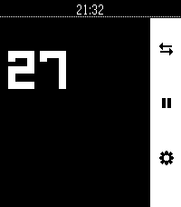

<!-- Generated by scripts/update_app_directory.py: do not edit by hand -->
[← All Pebble Developers](../developers.md)

# Perpetual Second-Hand

*1 app · Last updated 2026-10-11 · [About these lists](../about-app-lists.md)*

Links: [Pebble App Store](https://apps.repebble.com/apps/dev/perpetual-second-hand_3a875aec7946accb03ce9013) · [GitHub (david-s-svedberg)](https://github.com/david-s-svedberg)

<h2 class="app-name" id="app-14543cb7d5b94dc08eaf499a"><a href="https://apps.repebble.com/14543cb7d5b94dc08eaf499a">Brush</a> v1.3.0</h2>
<a class="app-source" href="https://github.com/david-s-svedberg/pebble-brush" title="Source code" data-search-exclude>View source</a>

App

Released 2026-06-26 Updated 2026-06-26

Runs on: Time 2, Pebble 2 Duo, Pebble 2, Time, Classic

Toothbrush timer with some configurability

