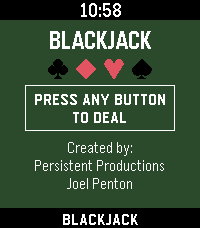
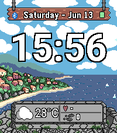

<!-- Generated by scripts/update_app_directory.py: do not edit by hand -->
[← All Pebble Developers](../developers.md)

# Persistent Productions

*1 watchface and 1 app · Last updated 2026-10-12 · [About these lists](../about-app-lists.md)*

Links: [Pebble App Store](https://apps.repebble.com/apps/dev/persistent-productions_807a6ca905cec674259b52f0) · [GitHub (Joel256)](https://github.com/Joel256)

<button type="button" data-filter="all" aria-pressed="true">All 2</button><button type="button" data-filter="watchface" aria-pressed="false">Watchfaces 1</button><button type="button" data-filter="watchapp" aria-pressed="false">Apps 1</button>

<label class="dev-sort">Sort by <select><option value="updated">Recently updated</option><option value="released">Newest release</option><option value="title">A–Z</option></select></label>

<h2 class="app-name" id="app-9dfa9b51de8c435583370427"><a href="https://apps.repebble.com/9dfa9b51de8c435583370427">Blackjack</a> v2.1</h2>
<a class="app-source" href="https://github.com/Joel256/Pebble-Blackjack" title="Source code" data-search-exclude>View source</a>

App

MIT Released 2026-04-06 Updated 2026-09-04

Runs on: Time 2, Pebble 2 Duo, Pebble 2, Time, Classic

Blackjack for Pebble Classic player vs. dealer, single 52 card deck, no betting Designed for Pebble 2 Duo Open source code — github.com/Joel256/Pebble-Blackjack Made by: Persistent Productions …

<h2 class="app-name" id="app-d44cfdd7bcb54f36aa8031a9"><a href="https://apps.repebble.com/d44cfdd7bcb54f36aa8031a9">Coastal Watchface T2</a> v1.0</h2>
<a class="app-source" href="https://github.com/Joel256/Coastal-T2" title="Source code" data-search-exclude>View source</a>

Watchface

MIT Released 2026-06-13 Updated 2026-06-13

Runs on: Time 2

A scenic pixel-art watchface inspired by the rugged coastline of Topsail Beach, Newfoundland. Built specifically for the Pebble Time 2. The background reacts to your local weather and the time of…

