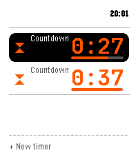

<!-- Generated by scripts/update_app_directory.py: do not edit by hand -->
[← All Pebble Developers](../developers.md)

# Persitz

*1 app · Last updated 2026-10-11 · [About these lists](../about-app-lists.md)*

Links: [Pebble App Store](https://apps.repebble.com/apps/dev/persitz_46f90f50f26e40f33ef52bde) · [GitHub (Persitz)](https://github.com/Persitz)

<h2 class="app-name" id="app-5673ae9a96914ac297bfec85"><a href="https://apps.repebble.com/5673ae9a96914ac297bfec85">Timers</a> v0.1.15</h2>
<a class="app-source" href="https://github.com/Persitz/pebble-timers" title="Source code" data-search-exclude>View source</a>

App

Apache-2.0 Released 2026-07-03 Updated 2026-07-30

Runs on: Time 2

Run several timers at once: countdowns, stopwatches with laps, and repeating intervals. Timers are easy to tell apart by color and size. Alarms buzz until you handle them and keep working when the…

