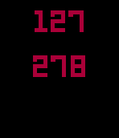

<!-- Generated by scripts/update_app_directory.py: do not edit by hand -->
[← All Pebble Developers](../developers.md)

# Pete Gestewitz

*1 app · Last updated 2026-10-11 · [About these lists](../about-app-lists.md)*

Links: [Pebble App Store](https://apps.repebble.com/apps/dev/pete-gestewitz_52b224cbcd4183800b00007e) · [GitHub (PGestewitz)](https://github.com/PGestewitz) · [Website (petegeste.co)](https://petegeste.co)

<h2 class="app-name" id="app-55b647c15e0716cd6b00005a"><a href="https://apps.repebble.com/55b647c15e0716cd6b00005a">Plus or Minus</a> v1.0</h2>
<a class="app-source" href="https://github.com/PGestewitz/Pebble-PlusorMinus" title="Source code" data-search-exclude>View source</a>

App

No licence Released 2015-07-27 Updated 2015-07-27

Runs on: Time 2, Time

You thought that calculators were your friends, but now your parent&#x27;s generation smokes you at basic math. You&#x27;re taking Calculus, but customers at your minimum wage job are still telling you how…

