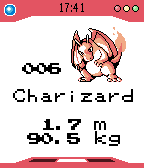

<!-- Generated by scripts/update_app_directory.py: do not edit by hand -->
[← All Pebble Developers](../developers.md)

# Peter-Berweiler.de

*1 app · Last updated 2026-10-11 · [About these lists](../about-app-lists.md)*

Links: [Pebble App Store](https://apps.repebble.com/apps/dev/peter-berweiler-de_5299f3a4e627ce4d500000ba) · [GitHub (shutdown27)](https://github.com/shutdown27) · [Website (peter-berweiler.de)](http://www.peter-berweiler.de/pebble.html)

<h2 class="app-name" id="app-52bb89bd7e4312c62d0000a4"><a href="https://apps.repebble.com/52bb89bd7e4312c62d0000a4">Pokedex Kanto</a> v2.1</h2>
<a class="app-source" href="http://github.com/shutdown27/pebble-Pokedex-App" title="Source code" data-search-exclude>View source</a>

App

No licence Released 2013-12-26 Updated 2016-10-08

Runs on: Round 2, Time 2, Pebble 2 Duo, Pebble 2, Time Round, Time, Classic

This Pokédex App lists all 151 Pokémon from the Kanto Region (First Generation). - Press Select to switch between different information (type, height/weight or a larger image) - Up/Down to scroll…

