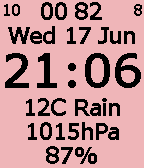
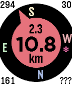
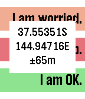
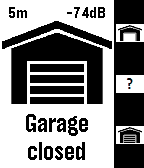
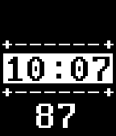

<!-- Generated by scripts/update_app_directory.py: do not edit by hand -->
[← All Pebble Developers](../developers.md)

# Peter Summers

*2 watchfaces and 3 apps · Last updated 2026-10-12 · [About these lists](../about-app-lists.md)*

Links: [Pebble App Store](https://apps.repebble.com/apps/dev/peter-summers_544f79d4ba44304f8400004c) · [Website (forums.pebble.com)](https://forums.pebble.com/t/watchapp-open-source-get-back-to-navigation-app/15090)

<button type="button" data-filter="all" aria-pressed="true">All 5</button><button type="button" data-filter="watchface" aria-pressed="false">Watchfaces 2</button><button type="button" data-filter="watchapp" aria-pressed="false">Apps 3</button>

<label class="dev-sort">Sort by <select><option value="updated">Recently updated</option><option value="released">Newest release</option><option value="title">A–Z</option></select></label>

<h2 class="app-name" id="app-5495e3173b132d5fae000004"><a href="https://apps.repebble.com/5495e3173b132d5fae000004">Moon, Health, Location and Weather Watch</a> v7.9</h2>
<a class="app-source" href="http://web.aanet.com.au/~summersfamily/moon_health_location_and_weather_watch_(7.8).zip" title="Source code" data-search-exclude>View source</a>

Watchface

Released 2014-12-20 Updated 2019-07-24

Runs on: Round 2, Time 2, Pebble 2 Duo, Pebble 2, Time Round, Time, Classic

This watch face displays the following: - time zone - phase of the moon (0-29 days, 0=new, 14=full), - location of the moon (0-99 x ~15-minute intervals), or - any one of Pebble&#x27;s health metrics…

<h2 class="app-name" id="app-550bf37f1e540c856300005e"><a href="https://apps.repebble.com/550bf37f1e540c856300005e">Get Back To</a> v5.18</h2>
<a class="app-source" href="http://web.aanet.com.au/~summersfamily/get_back_to_(5.17).zip" title="Source code" data-search-exclude>View source</a>

App

Released 2015-03-20 Updated 2019-07-24

Runs on: Round 2, Time 2, Pebble 2 Duo, Pebble 2, Time Round, Time, Classic

Get back to a previous location, or go to one selected from your list of favorites - built on the original by samualmr but now shows GPS accuracy, bearing, speed and heading, supports a list of…

<h2 class="app-name" id="app-56014a2508e93f4b6d000063"><a href="https://apps.repebble.com/56014a2508e93f4b6d000063">Send Message</a> v5.5</h2>
<a class="app-source" href="http://web.aanet.com.au/~summersfamily/send_message_(5.5).zip" title="Source code" data-search-exclude>View source</a>

App

Released 2015-09-22 Updated 2017-02-10

Runs on: Round 2, Time 2, Pebble 2 Duo, Pebble 2, Time Round, Time, Classic

GPS-aware HTTP client supporting GET and POST requests and server response verification or display. Allows configuration with three sets of label, URL, JSON data segment (if using POST) and string…

<h2 class="app-name" id="app-5717624b39001518cf000012"><a href="https://apps.repebble.com/5717624b39001518cf000012">Garadget Controller</a> v1.3</h2>
<a class="app-source" href="http://web.aanet.com.au/~summersfamily/garadget_controller_(1.3).zip" title="Source code" data-search-exclude>View source</a>

App

Released 2016-04-20 Updated 2017-01-07

Runs on: Round 2, Time 2, Pebble 2 Duo, Pebble 2, Time Round, Time, Classic

Remote control for the Garadget garage door controller. Shows door state, time since last change and wifi signal strength. Controls are as follows: Up: open door Down: close door Select: check…

<h2 class="app-name" id="app-5531a1c65b5f5463d000007e"><a href="https://apps.repebble.com/5531a1c65b5f5463d000007e">GPS Tester</a> v1.0</h2>
<a class="app-source" href="http://web.aanet.com.au/~summersfamily/gps_tester.zip" title="Source code" data-search-exclude>View source</a>

Watchface

Released 2015-04-18 Updated 2015-04-18

Runs on: Time 2, Pebble 2 Duo, Pebble 2, Time, Classic

Simple utility to test the age of GPS reads on your phone - runs once per minute and then displays the age in seconds of the GPS reading. This should be no more than six seconds, but in practice…

