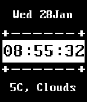

<!-- Generated by scripts/update_app_directory.py: do not edit by hand -->
[← All Pebble Developers](../developers.md)

# petermcconn

*1 watchface · Last updated 2026-10-12 · [About these lists](../about-app-lists.md)*

Links: [Pebble App Store](https://apps.repebble.com/apps/dev/petermcconn_5484be80a063216abf000088)

<h2 class="app-name" id="app-54c94eb3bcb000619a000062"><a href="https://apps.repebble.com/54c94eb3bcb000619a000062">Basic watchface</a> v1.0</h2>
<a class="app-source" href="https://cloudpebble.net/ide/project/123497#" title="Source code" data-search-exclude>View source</a>

Watchface

Released 2015-01-28 Updated 2015-01-28

Runs on: Time 2, Pebble 2 Duo, Pebble 2, Time, Classic

just your average watchface with the weather on it

