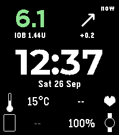

<!-- Generated by scripts/update_app_directory.py: do not edit by hand -->
[← All Pebble Developers](../developers.md)

# petrepa

*1 watchface · Last updated 2026-10-11 · [About these lists](../about-app-lists.md)*

Links: [Pebble App Store](https://apps.repebble.com/apps/dev/petrepa_6444ceb8513eb4512ac26246) · [GitHub (petrepa)](https://github.com/petrepa)

<h2 class="app-name" id="app-a5543813bd14472f90ff7542"><a href="https://apps.repebble.com/a5543813bd14472f90ff7542">Islet for AndroidAPS</a> v1.0.1</h2>
<a class="app-source" href="https://github.com/petrepa/islet-pebble" title="Source code" data-search-exclude>View source</a>

Watchface

Released 2026-09-26 Updated 2026-09-26

Runs on: Time 2

Diabetes watchface for AndroidAPS (AAPS) users. Shows glucose, trend arrow, delta, time since reading and insulin on board (IOB) straight from AndroidAPS on your phone. No Nightscout, xDrip+ or…

