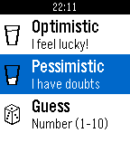

<!-- Generated by scripts/update_app_directory.py: do not edit by hand -->
[← All Pebble Developers](../developers.md)

# Petrolias Christopher

*1 app · Last updated 2026-10-11 · [About these lists](../about-app-lists.md)*

Links: [Pebble App Store](https://apps.repebble.com/apps/dev/petrolias-christopher_57213711a4a73c413e000006) · [GitHub (petrolias)](https://github.com/petrolias)

<h2 class="app-name" id="app-5728f7829e9134971d000002"><a href="https://apps.repebble.com/5728f7829e9134971d000002">Decision Maker</a> v1.8</h2>
<a class="app-source" href="https://github.com/petrolias/Pebble_DecisionMaker" title="Source code" data-search-exclude>View source</a>

App

Released 2016-05-03 Updated 2016-05-05

Runs on: Round 2, Time 2, Pebble 2 Duo, Pebble 2, Time Round, Time, Classic

The decision making process was never easy. This pebble app is here to help you out! Whether you are optimistic or pessimistic there is always a quote response for you!

