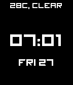

<!-- Generated by scripts/update_app_directory.py: do not edit by hand -->
[← All Pebble Developers](../developers.md)

# phdesign

*1 watchface · Last updated 2026-10-12 · [About these lists](../about-app-lists.md)*

Links: [Pebble App Store](https://apps.repebble.com/apps/dev/phdesign_56162c1e09fdf59f66000070) · [GitHub (phdesign)](https://github.com/phdesign)

<h2 class="app-name" id="app-561b188c3493944b11000039"><a href="https://apps.repebble.com/561b188c3493944b11000039">PHD</a> v1.4</h2>
<a class="app-source" href="https://github.com/phdesign/pebble-phd" title="Source code" data-search-exclude>View source</a>

Watchface

Released 2015-10-12 Updated 2016-04-03

Runs on: Time 2, Pebble 2 Duo, Pebble 2, Time, Classic

A minimalistic digital watchface for pebble with date display and weather. Weather is disabled by default, use the configuration screen to set your preferred provider (Yahoo Weather, Open Weather…

