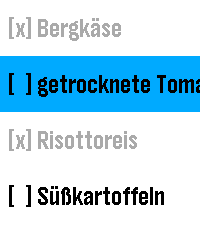

<!-- Generated by scripts/update_app_directory.py: do not edit by hand -->
[← All Pebble Developers](../developers.md)

# Philip Reinken

*1 app · Last updated 2026-10-12 · [About these lists](../about-app-lists.md)*

Links: [Pebble App Store](https://apps.repebble.com/apps/dev/philip-reinken_73690dd158662c5e6a6b77f1) · [GitHub (philipreinken)](https://github.com/philipreinken)

<h2 class="app-name" id="app-5996b590bda6450585ae6a6c"><a href="https://apps.repebble.com/5996b590bda6450585ae6a6c">Tandoor Recipes Shopping List</a> v0.0.3</h2>
<a class="app-source" href="https://github.com/philipreinken/pebble-tandoor-list" title="Source code" data-search-exclude>View source</a>

App

Released 2026-10-09 Updated 2026-10-11

Runs on: Time 2

Check your tandoor recipes shopping list on the go 📝 This app connects to a Tandoor instance, loads the current shopping list, and lets you mark items as checked directly from your Pebble watch.

