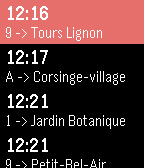

<!-- Generated by scripts/update_app_directory.py: do not edit by hand -->
[← All Pebble Developers](../developers.md)

# Philipp Schuler

*1 app · Last updated 2026-10-11 · [About these lists](../about-app-lists.md)*

Links: [Pebble App Store](https://apps.repebble.com/apps/dev/philipp-schuler_56acc5219f30b57e3c000023) · [GitHub (irgusite)](https://github.com/irgusite)

<h2 class="app-name" id="app-56b32f43a1eca08b5b000013"><a href="https://apps.repebble.com/56b32f43a1eca08b5b000013">Swiss Transport</a> v1.5</h2>
<a class="app-source" href="https://github.com/irgusite/SwissTP" title="Source code" data-search-exclude>View source</a>

App

Released 2016-02-04 Updated 2016-02-11

Runs on: Round 2, Time 2, Pebble 2 Duo, Pebble 2, Time Round, Time, Classic

This apps shows you the nearests public transport stations in switzerland. It uses the Swiss public transport API. The app uses the geolocation to show you the nearest stations and the 10 next…

