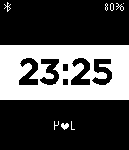

<!-- Generated by scripts/update_app_directory.py: do not edit by hand -->
[← All Pebble Developers](../developers.md)

# Philipp Stadler

*1 watchface · Last updated 2026-10-11 · [About these lists](../about-app-lists.md)*

Links: [Pebble App Store](https://apps.repebble.com/apps/dev/philipp-stadler_52f0fc73a0cb6a3d150007d9) · [GitHub (ansysic)](https://github.com/ansysic)

<h2 class="app-name" id="app-54457ded2a5191123d00012b"><a href="https://apps.repebble.com/54457ded2a5191123d00012b">Pebble Peek</a> v1.0</h2>
<a class="app-source" href="https://github.com/ansysic/Peek" title="Source code" data-search-exclude>View source</a>

Watchface

No licence Released 2014-10-20 Updated 2014-10-20

Runs on: Time 2, Pebble 2 Duo, Pebble 2, Time, Classic

This watchface is intended to only show notification icons from your phone and not the actual messasge. It&#x27;s an alpha version and still work in progress...

