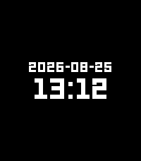
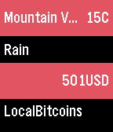

<!-- Generated by scripts/update_app_directory.py: do not edit by hand -->
[← All Pebble Developers](../developers.md)

# phntxx

*1 watchface and 2 apps · Last updated 2026-10-11 · [About these lists](../about-app-lists.md)*

Links: [Pebble App Store](https://apps.repebble.com/apps/dev/phntxx_541c14dad813567f3c0003c2) · [GitHub (PHNTXX)](https://github.com/PHNTXX)

<button type="button" data-filter="all" aria-pressed="true">All 3</button><button type="button" data-filter="watchface" aria-pressed="false">Watchfaces 1</button><button type="button" data-filter="watchapp" aria-pressed="false">Apps 2</button>

<label class="dev-sort">Sort by <select><option value="updated">Recently updated</option><option value="released">Newest release</option><option value="title">A–Z</option></select></label>

<h2 class="app-name" id="app-dbd21c5dd0614bef879e9ace"><a href="https://apps.repebble.com/dbd21c5dd0614bef879e9ace">13:12</a> v1.0.0</h2>
<a class="app-source" href="https://git.phntxx.com/bastian/pebble-watchface-1312" title="Source code" data-search-exclude>View source</a>

Watchface

Released 2026-08-25 Updated 2026-08-25

Runs on: Round 2, Time 2, Pebble 2 Duo, Pebble 2, Time Round, Time, Classic

The only watchface that always tells the correct time! The time on this watchface does not update. It&#x27;s always 13:12 (&quot;1312&quot; being &quot;ACAB&quot;, &quot;All Cops Are Bastards&quot;, encoded by the position of each…

<h2 class="app-name" id="app-5717ea24a86f0f5c67000008"><a href="https://apps.repebble.com/5717ea24a86f0f5c67000008">json_pull</a> v1.7</h2>
<a class="app-source" href="https://github.com/PHNTXX/first_pebble_app" title="Source code" data-search-exclude>View source</a>

App

No licence Released 2016-04-20 Updated 2016-08-26

Runs on: Round 2, Time 2, Pebble 2 Duo, Pebble 2, Time Round, Time, Classic

my first pebble app. basically just pulls information from json apis. credit goes to openweathermap, bitcoinaverage and theysaidso for the apis.

<h2 class="app-name" id="app-5741ff45bf2492f9ce000011"><a href="https://apps.repebble.com/5741ff45bf2492f9ce000011">dashboard</a> v1.3</h2>
<a class="app-source" href="http://github.com/PHNTXX/dashboard" title="Source code" data-search-exclude>View source</a>

App

MIT Released 2016-05-22 Updated 2016-05-26

Runs on: Round 2, Time 2, Pebble 2 Duo, Pebble 2, Time Round, Time, Classic

my first c app. basically just shows you the weather and bitcoin value at a glance. this version is not really complete yet, so please keep that in mind while using the app. credit goes to…

