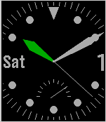

<!-- Generated by scripts/update_app_directory.py: do not edit by hand -->
[← All Pebble Developers](../developers.md)

# Pierre Crette

*1 watchface · Last updated 2026-10-11 · [About these lists](../about-app-lists.md)*

Links: [Pebble App Store](https://apps.repebble.com/apps/dev/pierre-crette_55e08e9d90d2265e41000039) · [GitHub (PierreCrette)](https://github.com/PierreCrette)

<h2 class="app-name" id="app-57efe9f105e4b17e1c0001c8"><a href="https://apps.repebble.com/57efe9f105e4b17e1c0001c8">BigAnalog3</a> v3.1</h2>
<a class="app-source" href="https://github.com/PierreCrette/BigAnalog3" title="Source code" data-search-exclude>View source</a>

Watchface

GPL-3.0 Released 2016-10-01 Updated 2016-10-08

Runs on: Round 2, Time 2, Pebble 2 Duo, Pebble 2, Time Round, Time, Classic

BigAnalog v3 is still easier to read without glasses, and is still battery efficient to last 5 days long (Time). BigAnalog v3 now adds second hand for a few seconds if you shake the pebble, and…

