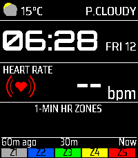
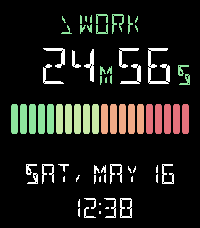
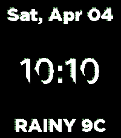

<!-- Generated by scripts/update_app_directory.py: do not edit by hand -->
[← All Pebble Developers](../developers.md)

# pikaring

*3 watchfaces · Last updated 2026-10-11 · [About these lists](../about-app-lists.md)*

Links: [Pebble App Store](https://apps.repebble.com/apps/dev/pikaring_54f06d8a380aa6dffe00005b) · [GitHub (pikaring)](https://github.com/pikaring)

<button type="button" data-filter="all" aria-pressed="true">All 3</button><button type="button" data-filter="watchface" aria-pressed="false">Watchfaces 3</button><button type="button" data-filter="watchapp" aria-pressed="false" disabled>Apps 0</button>

<label class="dev-sort">Sort by <select><option value="updated">Recently updated</option><option value="released">Newest release</option><option value="title">A–Z</option></select></label>

<h2 class="app-name" id="app-1b14e369c9f440cfa6582789"><a href="https://apps.repebble.com/1b14e369c9f440cfa6582789">CycleHR</a> v1.1.0</h2>
<a class="app-source" href="https://github.com/pikaring/ubiquitous-space-broccoli" title="Source code" data-search-exclude>View source</a>

Watchface

Released 2026-06-11 Updated 2026-06-24

Runs on: Time 2, Pebble 2 Duo, Pebble 2

English CycleHR — Heart-Rate Cycling Watchface CycleHR is a watchface built for cyclists who want to keep an eye on their effort at a glance. Alongside a bold, easy-to-read clock it shows your…

<h2 class="app-name" id="app-f92e3432555743c5b9a59906"><a href="https://apps.repebble.com/f92e3432555743c5b9a59906">Timer Bar Visual</a> v1.1.5</h2>
<a class="app-source" href="https://github.com/pikaring/ubiquitous-space-broccoli" title="Source code" data-search-exclude>View source</a>

Watchface

Released 2026-05-16 Updated 2026-05-16

Runs on: Time 2, Pebble 2 Duo, Pebble 2, Time, Classic

This watch face is inspired by KINGGIM&#x27;s visual bar timer. • Pomodoro Timer Mode: Displays work hours and break times, and the watch vibrates when switching between modes. • Work Schedule Mode…

<h2 class="app-name" id="app-d56554adafa0412abf024454"><a href="https://apps.repebble.com/d56554adafa0412abf024454">Game of life</a> v1.11</h2>
<a class="app-source" href="https://github.com/pikaring/ubiquitous-space-broccoli" title="Source code" data-search-exclude>View source</a>

Watchface

Released 2026-04-04 Updated 2026-04-04

Runs on: Round 2, Time 2, Time Round, Time

This is Game of Life watchface.

